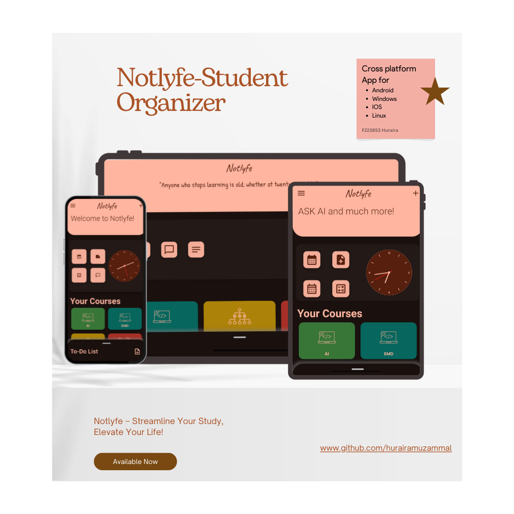
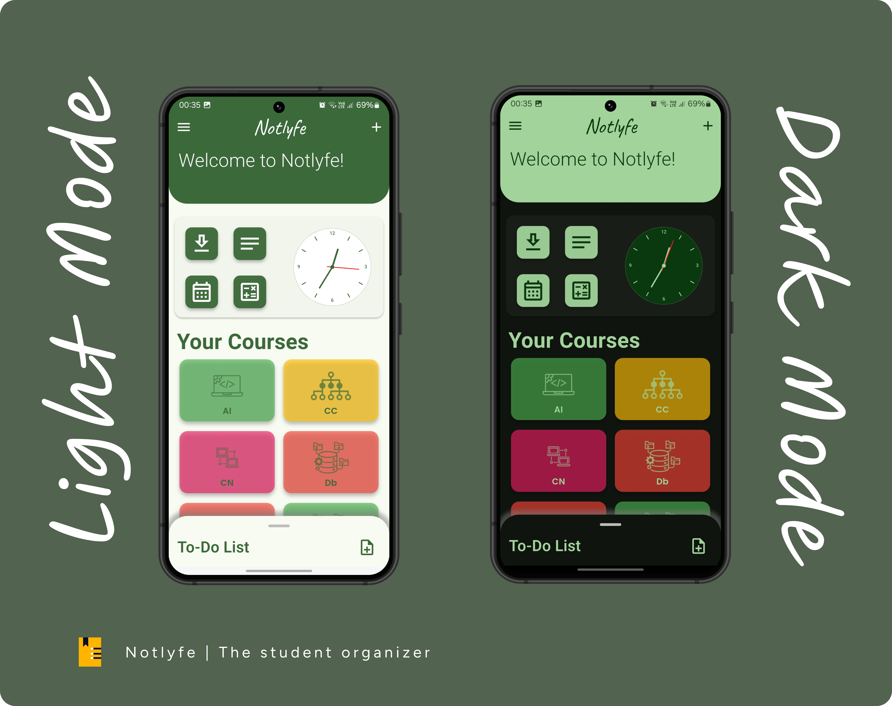
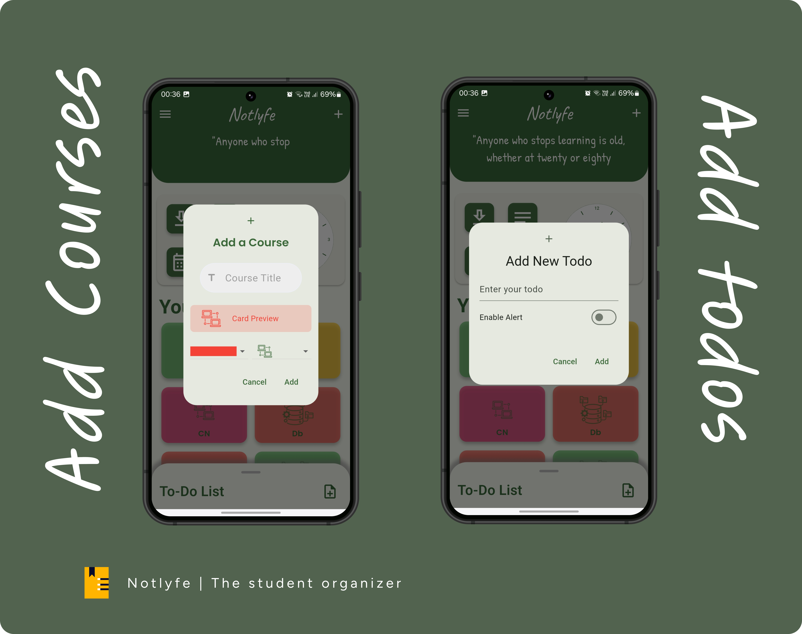
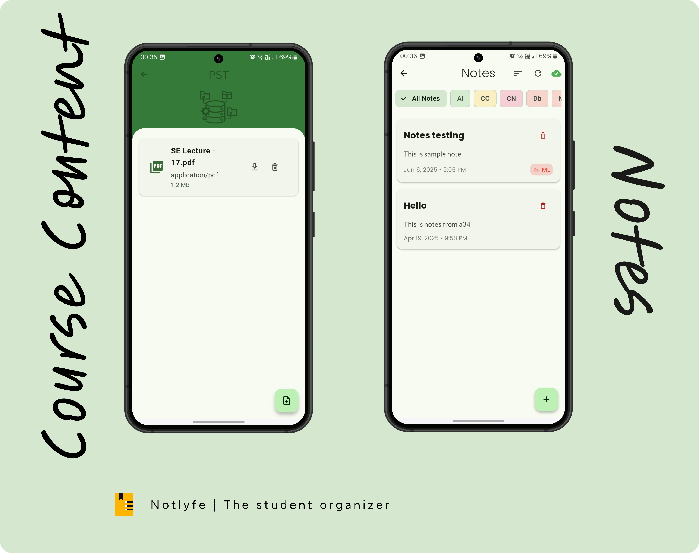
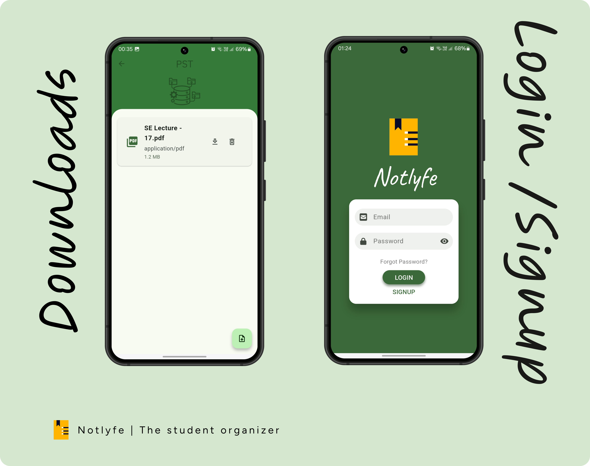

<p align="center">
  
</p>

<h1 align="center">Notlyfe — Encrypted Offline-First Student Workspace</h1>

<p align="center">
  An open-source, end-to-end encrypted Flutter workspace for <strong>Android</strong>, <strong>Linux</strong>, and <strong>Windows</strong>.<br/>
  Manage courses, lecture files, rich-text notes, tasks, calendar schedules, and CGPA goals — with pluggable cloud or self-hosted storage.
</p>

<p align="center">
  <a href="https://github.com/hurairamuzammal/Notlyfe-Student-Oragnizer/releases/latest">
    
  </a>
  <a href="https://hurairamuzammal.github.io/Notlyfe-Student-Oragnizer/">
    
  </a>
  <a href="https://hurairamuzammal.github.io/Notlyfe-Student-Oragnizer/privacy.html">
    
  </a>
  <a href="LICENSE">
    
  </a>
</p>

<p align="center">
  
  
  
  
  
  
</p>

---

## Preview

<table align="center">
  <tr>
    <td align="center"></td>
    <td align="center"></td>
    <td align="center"></td>
    <td align="center"></td>
  </tr>
</table>

> **Live Site:** [hurairamuzammal.github.io/Notlyfe-Student-Oragnizer](https://hurairamuzammal.github.io/Notlyfe-Student-Oragnizer/) &nbsp;|&nbsp; **Privacy Policy:** [privacy.html](https://hurairamuzammal.github.io/Notlyfe-Student-Oragnizer/privacy.html) &nbsp;|&nbsp; **Password Reset:** [/reset/](https://hurairamuzammal.github.io/Notlyfe-Student-Oragnizer/reset/)

---

## Key Features

| Area | Capabilities |
| :--- | :--- |
| **Courses & Study Files** | Color-coded Material 3 Expressive course cards, custom icons, lecture PDF/slide uploads, offline file downloads, and safe local file management. |
| **Rich-Text Notes (E2EE)** | Full Quill rich-text editor with headings, checklists, highlights, custom Google Fonts, paper themes, synced default styles, and course tagging. |
| **Persistent Google Drive Setup** | One-time onboarding setup (`DriveSetupScreen`) using folder-only `drive.file` scope, silent account restore on launch, encrypted token persistence, and automatic HTTP `401` refresh + retry. |
| **Pluggable Storage Backends** | Choose where files and notes live: **Google Drive**, **Nextcloud / WebDAV**, **Custom REST/HTTP Server**, **Local Folder**, or **Supabase**. See [docs/CUSTOM_STORAGE.md](docs/CUSTOM_STORAGE.md). |
| **Offline-First SQLite Sync** | Local SQLite (`sqflite` on mobile, `sqflite_common_ffi` on Linux & Windows) keeps courses, notes, and todos usable offline and safely merges unsynced edits when back online. |
| **Tasks, Calendar & Study Tools** | Draggable todo sheet, Gregorian + Hijri calendar, CGPA calculator, focus clock, Material You dynamic theming, and optional **BYOK Gemini AI** study assistant. |

---

## Security Architecture

Notlyfe `v2.1.0+3` is engineered with defense-in-depth across local storage, cloud sync, and client lifecycle:

- **Client-Side E2EE (`enc:v2:`):** Notes and todos are encrypted on-device with AES-256-CBC + HMAC-SHA256 using domain-separated encryption and MAC subkeys derived from each user's 256-bit vault key (backward-compatible with `enc:v1:`). Encryption fails closed (`StateError`) if uninitialized, keys are scrubbed from memory on sign-out, and Settings displays only a non-reversible SHA-256 fingerprint.
- **Encrypted Local Secret Vault (`v3:`):** API keys, Google Drive OAuth tokens, and vault keys are encrypted with AES-256-CBC + HMAC-SHA256 bound to each storage slot name (preventing ciphertext swapping), with the master key stored in an app-private `0600` file outside `SharedPreferences`.
- **Android Cloud Backup Disabled:** `android:allowBackup="false"` and `android:fullBackupContent="false"` prevent extraction of local databases and keys via backup agents.
- **Session & Data Isolation:** Sign-out clears the navigation stack (`pushAndRemoveUntil`), wipes in-memory caches and todos, and binds Drive tokens to the active Notlyfe user ID.
- **Minimum Version Gate (`>= v2.1.0+3`):** Older builds are blocked both server-side via Supabase RLS (`public.is_client_version_supported()` checking `x-notlyfe-build`) and client-side via `AppVersionService` (`version_policy.json` + Supabase `app_config`) with an offline-cached floor.

---

## Downloads (`v2.1.0`)

Grab the pre-built release for your platform from [GitHub Releases](https://github.com/hurairamuzammal/Notlyfe-Student-Oragnizer/releases/latest):

| Platform | Artifact | Notes |
| :--- | :--- | :--- |
| **Android (ARM64)** | `notlyfe-v2.1.0-android-arm64-v8a.apk` | Recommended for most modern Android phones |
| **Android (ARMv7)** | `notlyfe-v2.1.0-android-armeabi-v7a.apk` | Older 32-bit ARM Android devices |
| **Android (x86_64)** | `notlyfe-v2.1.0-android-x86_64.apk` | x86_64 Android tablets / emulators |
| **Android (Universal)** | `notlyfe-v2.1.0-android-universal.apk` | All ABIs in one package |
| **Linux (x64)** | `notlyfe-v2.1.0-linux-x64.tar.gz` | Extract and run `./bundle/notlyfe` |
| **Windows (x64)** | `notlyfe-v2.1.0-windows-x64.zip` | Extract and run `notlyfe.exe` |

---

## Building from Source

### Prerequisites
- **Flutter SDK** (Dart `^3.6.0`)
- **Android:** Android SDK + JDK 17/21
- **Linux Desktop:** `clang`, `cmake`, `ninja-build`, `pkg-config`, `libgtk-3-dev`
- **Windows Desktop:** Visual Studio 2022 with Desktop development with C++

### Run & Test Locally

```bash
git clone https://github.com/hurairamuzammal/Notlyfe-Student-Oragnizer.git
cd Notlyfe-Student-Oragnizer
flutter pub get
flutter test
flutter run
```

### Build Release Packages

```bash
# Android (split APKs + universal)
flutter build apk --release --split-per-abi
flutter build apk --release

# Linux x64 desktop
flutter build linux --release

# Windows x64 desktop (run on Windows)
flutter build windows --release
```

To point a custom build at your own Supabase project:

```bash
flutter build apk --release \
  --dart-define=SUPABASE_URL=https://your-project.supabase.co \
  --dart-define=SUPABASE_ANON_KEY=your-anon-key
```

### Supabase Backend Setup
1. Apply [supabase/migrations/20261124_enforce_min_version.sql](supabase/migrations/20261124_enforce_min_version.sql) and [supabase/enable_rls.sql](supabase/enable_rls.sql) to configure Row-Level Security and server-side minimum build enforcement.
2. Add `https://hurairamuzammal.github.io/Notlyfe-Student-Oragnizer/reset/` to **Supabase Auth -> URL Configuration -> Redirect URLs**.

---

## Project Structure

```text
Notlyfe-Student-Oragnizer/
├── .github/workflows/   CI tests, Windows release builds, and GitHub Pages deployment
├── docs/                Custom storage provider guide (docs/CUSTOM_STORAGE.md)
├── lib/
│   ├── data/            Course icons & quick shortcuts
│   ├── database/        Supabase & local SQLite (sqflite / FFI) repositories
│   ├── models/          Course, Note, Todo, UserProfile, and note style models
│   ├── providers/       Riverpod state, connectivity, theming, and sync providers
│   ├── screens/         App UI (Home, Courses, Rich Note Editor, Drive Setup, Settings)
│   ├── services/        Auth, E2EE (v2), SecureStorage (v3), Google Drive, Version Gate, Storage Providers
│   ├── utils/           Note content codec & cross-platform toast helpers
│   └── widgets/         Material 3 Expressive components & cards
├── site/                GitHub Pages site (Landing Page, Privacy Policy, Password Reset Portal)
├── supabase/            RLS policies, version-gate migration, and reset-password Edge Function
├── test/                Unit, security, version-gate, and storage contract tests (30 passing)
└── version_policy.json  Remote minimum-version policy checked on startup/resume
```

---

## Documentation, Privacy & License

- **Website:** [https://hurairamuzammal.github.io/Notlyfe-Student-Oragnizer/](https://hurairamuzammal.github.io/Notlyfe-Student-Oragnizer/)
- **Privacy Policy:** [https://hurairamuzammal.github.io/Notlyfe-Student-Oragnizer/privacy.html](https://hurairamuzammal.github.io/Notlyfe-Student-Oragnizer/privacy.html)
- **Custom Storage Spec:** [docs/CUSTOM_STORAGE.md](docs/CUSTOM_STORAGE.md)
- **SRS & System Docs:** [Complete-Documentation/](Complete-Documentation/)
- **License:** Released under the [MIT License](LICENSE).
